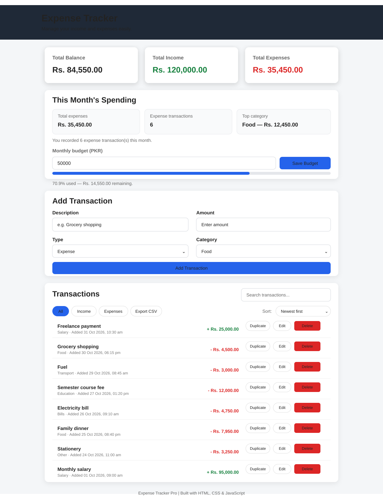

# Expense Tracker Pro

A responsive, browser-based expense tracker built with **HTML5, CSS3, and vanilla JavaScript**. The project demonstrates front-end fundamentals, transaction management, browser storage, filtering, and CSV export.

## Dashboard Preview



*Desktop preview populated with sample transactions; the displayed figures are illustrative.*

## Features

- Add, edit, duplicate, and undo deletion of income and expense transactions
- Attach optional notes to transactions for extra context
- View total income, expenses, and current balance
- Search transactions by description, category, type, or amount
- Filter transaction history by an inclusive start and end date
- Filter transactions by type and sort by date or amount
- View this month's total expenses, transaction count, and top spending category
- Set a monthly spending budget and track usage with a progress indicator
- Confirm before deleting a transaction
- Save transaction data in browser `localStorage`
- Export transactions to a CSV file for spreadsheet analysis
- Download and restore a versioned JSON backup of transactions and monthly budget
- Responsive layout for desktop and mobile screens

## Tech Stack

| Technology | Purpose |
| --- | --- |
| HTML5 | Semantic page structure and form controls |
| CSS3 | Layout, styling, and responsive design |
| JavaScript (ES6+) | Application logic, events, and data processing |
| Web Storage API | Persist transactions in the browser |
| Blob and URL APIs | Generate and download CSV exports |

## Run Locally

1. Clone the repository:

   ```bash
   git clone https://github.com/Ali204-hub/javascripts_projects-.git
   ```

2. Open the project folder.
3. Open `index.html` in your browser.

No package installation or build step is required.

## Quick Test Checklist

- [ ] Add an income transaction with notes and confirm the notes appear in its history row.
- [ ] Edit and duplicate a transaction with notes, then confirm the notes are preserved.
- [ ] Add an expense and confirm the balance recalculates.
- [ ] Search by a transaction description, category, type, and amount.
- [ ] Filter transactions with a start date, an end date, and an invalid date range.
- [ ] Switch between All, Income, and Expenses filters.
- [ ] Cancel a delete confirmation and confirm the transaction remains.
- [ ] Export transactions and open the downloaded CSV in a spreadsheet app.
- [ ] Download a JSON backup, then restore it after confirming the replacement prompt.
- [ ] Try importing invalid JSON and confirm the saved data remains unchanged.
- [ ] Refresh the page and confirm saved transactions remain.

## What I Practiced

- DOM selection and event handling
- Arrays, objects, and array filtering
- Form validation and CRUD-style operations
- Calculating totals from transaction data
- Persisting data with `localStorage`
- Escaping displayed text and formatting CSV cells
- Saving and displaying optional transaction notes safely
- Creating browser downloads with the Blob API
- Validating versioned JSON backups and restoring browser storage safely
- Writing project documentation and manual test cases

## Current Limitations

- Data is stored locally in the current browser and is not synced across devices.
- There is no backend, user authentication, or cloud database.
- CSV export and JSON backup/restore should be manually tested in the target browser.

## Author

**Syed Ali Imam Shah**  
Computer Science Student | Aspiring Software Developer

[GitHub Profile](https://github.com/Ali204-hub)

---

*Built as a hands-on project to strengthen practical JavaScript and front-end development skills.*
